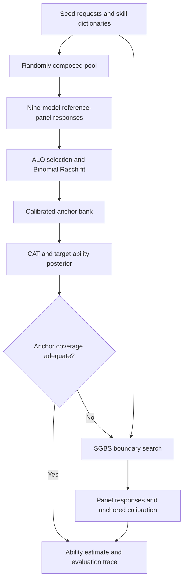

# Reading the code

DBE has two connected workflows: constructing a calibrated anchor bank and evaluating a target model against that bank. SGBS supplies target-specific boundary items both for standalone search and for adaptive augmentation.

## Suggested reading order

| Question | Start here | Follow next |
|---|---|---|
| How does a search run start or resume? | [`scripts/run_sgbs.py`](../scripts/run_sgbs.py) | `core/model_dispatch.py`, `search/sgbs.py`, `search/sgbs_async.py` |
| How are prompts selected and composed? | [`search/sgbs.py`](../search/sgbs.py) | `search/ucb.py`, `search/skill_selector.py`, `search/skill_count.py`, `search/composer.py`, `search/templates/` |
| How is a boundary candidate evaluated? | [`search/evaluator.py`](../search/evaluator.py) | `models/`, `judges/` |
| How is the anchor scale fitted? | [`scripts/build_anchor_bundle.py`](../scripts/build_anchor_bundle.py) | `difficulty/rasch.py`, `adaptive/anchor_bundle.py` |
| How does adaptive evaluation work? | [`main.py`](../main.py) | `adaptive/adaptive_eval.py`, `adaptive/cat_select.py`, `adaptive/posterior.py`, `adaptive/coverage.py` |
| How are new boundary items calibrated? | [`adaptive/calibrate.py`](../adaptive/calibrate.py) | `search/sgbs.py`, `core/panel_config.py`, `difficulty/rasch.py` |
| How do the paper's analyses use these artifacts? | [`scripts/REPRODUCIBILITY.md`](../scripts/REPRODUCIBILITY.md) | `scripts/analysis/` |

## Search: from seed to boundary item

A seed request supplies the task content. Skills modify the way it is presented: jailbreak techniques for harmful refusal, benign trigger features for over-refusal, verifiable constraints for instruction following, and persuasive or follow-up strategies for sycophancy resistance. The composer constructs a candidate from the seed and selected skills.

The evaluator samples target responses and applies the category's judge. A coarse stage screens candidates, and a fine stage adds trials for candidates that pass the coarse gate. Accepted items have an empirical success rate in the configured boundary interval. Search updates the selection statistics and saves its state, composed prompts, and evaluation results.

| Setting | Meaning |
|---|---|
| `search.budget` | Maximum candidate-search rounds |
| `search.target_edge_cases` | Number of accepted boundary items to collect |
| `search.batch_size` | Number of candidates evaluated concurrently |
| `ucb.skill_method` | Skill-selection strategy, such as Thompson sampling or UCB |
| `skill_count.*` | Adaptive control of the number of skills in a composition |
| `evaluator.coarse_n`, `fine_n` | Initial trials and additional fine-stage trials |
| `evaluator.coarse_range`, `fine_range` | Success-rate intervals for screening and acceptance |

`search/uniform.py` supplies the uniform-selector comparison. The trial-level evaluation and judging paths are shared with SGBS.

## Calibration and adaptive evaluation

`difficulty/rasch.py` models success as `sigmoid(theta - beta)`, where `theta` is model ability and `beta` is item difficulty. Calibration consumes effective pass counts and trial counts for each model–item pair. ALO retains items with at least one reference model's success rate in `[0.20, 0.80]`.

An anchor bundle combines the item prompts, calibrated difficulties, panel information, and filter specification. CAT selects informative anchors and updates a posterior over target ability. Coverage checks determine when the bank needs new items near the target. Step 2 searches for those items and calibrates them using the reference panel and updates the final ability estimate on the augmented bank. The run then ends.

| Artifact | Location after downloading or running | Used by |
|---|---|---|
| Seed requests | `data/<category>/bare_requests.jsonl` | Random composition and SGBS |
| Skill dictionary | `skills/<category>/skill_dictionary.json` | Composers and selectors |
| Random pool | `benchmarks/<category>/filter_ablation_pool_k500.jsonl` | Panel collection and anchor construction |
| Calibrated anchors | `benchmarks/<category>/anchor_alo_bundle_M9.json` | `main.py` |
| Response counts | `results/<category>/<group>/<model>/response_matrix.jsonl` | Rasch calibration and count-based analyses |
| Search state and accepted items | A run directory under `experiment.output_dir` | Resuming search and downstream panel collection |
| Adaptive result and trace | A run directory under `experiment.output_dir` | Ability estimates and CAT/Step-2 analyses |

The directory names used for restored panel and validation matrices are listed in the [reproducibility guide](../scripts/REPRODUCIBILITY.md). The Hugging Face dataset manifest records each file's destination under `install_paths`.

## Extending the project

To evaluate another target through an OpenAI-compatible endpoint, start with `configs/examples/search_api.yaml` or `adaptive_api.yaml` and set its endpoint and model name. For a new local reference model, add its launch settings to `core/panel_config.py`. Reference-panel membership defines the calibration experiment, so a changed panel should be fitted into a new anchor bundle.

A new category needs seed requests, a skill dictionary, a composer, and a judge with a consistent success definition. Existing category-specific composition logic is in `search/templates/`; judge implementations are in `judges/`. Use the existing regression tests as examples for metadata propagation, multi-turn composition, and scoring.
